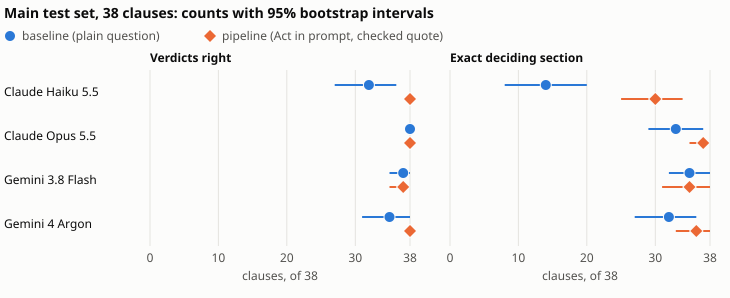

# Lease Clause Checker

**Can you trust an AI to read your lease?**

This project tests large language models on clauses from Ontario residential leases, measures
where they go wrong, and tests a pipeline that only answers when it can back the answer with a
citation it has checked.

> **Not legal advice.** This is a research and evaluation project. Its output may be wrong. If
> you have a question about your tenancy, contact a lawyer, a community legal clinic, or the
> Landlord and Tenant Board.

## Why

A chatbot answer can sound right and still cite the wrong section of the law, or no section at
all. A reader has no easy way to tell. This project measures how often that happens and tests one
mitigation.

## Approach

1. Give the model the relevant sections of the
   [Residential Tenancies Act, 2006](https://www.ontario.ca/laws/statute/06r17) (Ontario).
2. Require structured output: a verdict (`void` / `allowed` / `unsure`), a section number, and a
   verbatim quote from that section.
3. Check in code that the quote really appears in the cited section, after normalising
   whitespace and quotation marks.
4. Retry once if the check fails; otherwise return `unsure`.

The same synthetic test clauses are run through a plain "is this enforceable?" prompt as a
baseline, and both methods are scored with deterministic code (no LLM judge) on verdict accuracy,
false alarms on lawful clauses, citation validity, and how often the model says `unsure`.

## Status

Work in progress. These exist:

- the statute fetcher;
- the rule list ([data/rules.yaml](data/rules.yaml)): 18 RTA sections, each with its e-Laws
  heading, a one-line paraphrase and a link;
- a test set of 38 synthetic clauses ([data/clauses.jsonl](data/clauses.jsonl)), covering 16
  of the 18 rules, reviewed by two people and frozen before any model saw it (see
  [data/README.md](data/README.md)).
  s. 4 decides no clause on its own, and s. 22 turns on facts about how much interference
  there was.

- a baseline: the plain prompt in [prompts/baseline-v1.txt](prompts/baseline-v1.txt), run on a
  light and a heavy model from Anthropic and from Google, paired by tier: Claude Haiku 5.5 with
  Gemini 3.8 Flash, Claude Opus 5.5 with Gemini 4 Argon
  ([models.py](src/lease_clause_checker/models.py) records the model ids and prices). Every raw
  answer is saved in [results/](results/) with the model, prompt version and date, and scoring
  is deterministic code that reads only the answer's final "Verdict:" and "Section:" lines.

- the grounded pipeline ([pipeline.py](src/lease_clause_checker/pipeline.py), prompt in
  [prompts/pipeline-v1.txt](prompts/pipeline-v1.txt)): the text of all 18 rule sections in
  the prompt, a JSON answer (verdict `void` / `allowed` / `unsure`, section, quote, reason),
  a quote check in code ([verify.py](src/lease_clause_checker/verify.py)), one retry that tells
  the model what failed, and `unsure` if the retry fails too. A quote passes when, after
  whitespace and quotation marks are normalised, it appears word for word within one
  subsection of the cited section and has at least five words, not counting markers such as
  "(2)" or "(a)". Quoting a heading is reported separately from a quote that isn't there.

- a stress set of 14 clauses chosen because Claude Haiku 5.5 got them wrong
  ([data/README.md](data/README.md#stressjsonl-the-stress-set)), reported apart from the main
  set.

- a demo command, `lcc check`, that runs the pipeline on each clause of a lease
  ([check.py](src/lease_clause_checker/check.py); see [Check a lease](#check-a-lease)).

Results are in [Results](#results) below.

To re-score everything and regenerate the results below, offline:

```sh
uv sync
uv run lcc statute fetch      # the Act, needed for the pipeline and for scoring citations
make report                   # rewrites the Results section and results/scoreboard.svg
```

To re-run a method (`run` calls paid APIs; answers already in `results/` are reused) or see
every wrong answer: `uv run lcc baseline run`, `uv run lcc pipeline report --details`, and so
on. Add `--clauses data/stress.jsonl` for the stress set.

None of the four models accepts a temperature setting, so each runs with its provider's
default sampling; reproducibility comes from the saved answers, not from re-calling the APIs.

### Check a lease

```sh
cp .env.example .env                        # then add ANTHROPIC_API_KEY
uv run lcc statute fetch
uv run lcc check samples/lease_short.txt
```

[samples/lease_short.txt](samples/lease_short.txt) is a short synthetic lease written for the
demo. Its clauses are not copied from the test set, but most of them test the same rules as
test-set clauses (clause 3 and c25, for example), so the demo is not an out-of-sample result.
Each numbered clause gets the pipeline's verdict, the section it cites, the quote (checked
against the Act's text) and a link to the section on e-Laws. The model is Claude Haiku 5.5
unless `--model` names another. Each clause costs one paid call, or two when a quote fails the
check; the answers are saved, so checking the same lease again costs nothing. The sample's
answers are committed in [results/check/](results/check/), so the command above replays them
without a key. Only the 18 rule sections are in the prompt, so a clause about anything else
may get a wrong or `unsure` answer. Two of the eight clauses, from a run on 13 November 2026
(the first run took 5 to 6 seconds for all eight):

```text
  2  VOID     Pets are not allowed in the apartment or the building.
              s. 14, “No pet” provisions void
              “A provision in a tenancy agreement prohibiting the presence of
              animals in or about the residential complex is void.”
              https://www.ontario.ca/laws/statute/06r17#BK19

  6  VOID     The Tenant will pay a non-refundable $250 fee for each set of keys
              issued at the start of the tenancy.
              s. 134, Additional charges prohibited
              “collect or require or attempt to collect or require from a
              tenant, prospective tenant or former tenant of the rental unit a
              fee, premium, commission, bonus, penalty, key deposit or other
              like amount of money whether or not the money is refundable”
              https://www.ontario.ca/laws/statute/06r17#BK207
```

## Results

Everything in this section is generated by `make report` from the saved answers in
[results/](results/); no API is called.

<!-- scoreboard:start (generated by `make report`; edit scoreboard.py, not this) -->

Answers collected 11–13 November 2026 (UTC).

### Headline: a light model with the pipeline vs a heavy model alone

Main test set, 38 clauses. In brackets: 95% bootstrap intervals over clauses (10,000 resamples, fixed seed); for the difference, a paired bootstrap.

| | verdicts right | exact deciding section | cost for the 38 clauses |
|---|---|---|---|
| Claude Haiku 5.5 + pipeline (light) | 38 of 38 (see Notes) | 30 of 38 (25–34) | $0.036 |
| Claude Opus 5.5 alone (heavy) | 38 of 38 (see Notes) | 33 of 38 (29–37) | $0.77 |
| difference | 0 (see Notes) | −3 (−7 to +1) | |
| Gemini 3.8 Flash + pipeline (light) | 37 of 38 (35–38); 1 unsure | 35 of 38 (31–38) | $0.68 |
| Gemini 4 Argon alone (heavy) | 35 of 38 (31–38) | 32 of 38 (27–36) | $0.072 |
| difference | +2 (0 to +5) | +3 (−2 to +8) | |

A difference counts only if its interval excludes 0; a gap of 1–2 clauses is not called a difference.

Without the contested clauses (c29, c32; see Notes), 36 clauses, verdicts right and exact sections: Claude Haiku 5.5 + pipeline 36 and 29; Claude Opus 5.5 alone 36 and 32; Gemini 3.8 Flash + pipeline 36 and 34; Gemini 4 Argon alone 35 and 32.

### Every model and method on the main set

38 clauses: 22 void, 16 allowed.

| model | method | verdicts right | false alarms | missed voids | unsure | quote verified | section ok | exact section | cost |
|---|---|---|---|---|---|---|---|---|---|
| Claude Haiku 5.5 (light) | baseline | 32 of 38 (27–36) | 4 of 16 | 2 of 22 | – | – | 21 of 38 | 14 of 38 (8–20) | $0.034 |
| Claude Haiku 5.5 (light) | pipeline | 38 of 38 (see Notes) | 0 of 16 | 0 of 22 | 0 | 38 of 38 | 36 of 38 | 30 of 38 (25–34) | $0.036 |
| Claude Opus 5.5 (heavy) | baseline | 38 of 38 (see Notes) | 0 of 16 | 0 of 22 | – | – | 36 of 38 | 33 of 38 (29–37) | $0.77 |
| Claude Opus 5.5 (heavy) | pipeline | 38 of 38 (see Notes) | 0 of 16 | 0 of 22 | 0 | 38 of 38 | 37 of 38 | 37 of 38 (35–38) | $1.08 |
| Gemini 3.8 Flash (light) | baseline | 37 of 38 (35–38) | 1 of 16 | 0 of 22 | – | – | 36 of 38 | 35 of 38 (32–38) | $0.18 |
| Gemini 3.8 Flash (light) | pipeline | 37 of 38 (35–38) | 0 of 16 | 0 of 22 | 1 | 37 of 38 | 37 of 38 | 35 of 38 (31–38) | $0.68 |
| Gemini 4 Argon (heavy) | baseline | 35 of 38 (31–38) | 3 of 16 | 0 of 22 | – | – | 34 of 38 | 32 of 38 (27–36) | $0.072 |
| Gemini 4 Argon (heavy) | pipeline | 38 of 38 (see Notes) | 0 of 16 | 0 of 22 | 0 | 38 of 38 | 37 of 38 | 36 of 38 (33–38) | $0.40 |

- **false alarms**: lawful clauses called void. **missed voids**: void clauses called lawful.
- **quote verified**: the final answer's quote passed the check, so the cited section exists and contains the quote. The baseline gives no quote to check.
- **section ok** counts the deciding section or an accepted alternative (s. 4 for every void clause, for example); **exact section** counts the deciding section only.
- **cost**: list prices on the day of each call, retries included. The Gemini calls went through Vertex AI but are priced at the Gemini API's list prices (see [results/README.md](results/README.md)).



Main-set clauses where a light model had the verdict and an accepted section and its heavy sibling, by the same method, did not: c29 (baseline: Claude Opus 5.5 cited s. 120; Claude Haiku 5.5 cited s. 116); c03 (baseline: Gemini 4 Argon cited s. 33; Gemini 3.8 Flash cited s. 14); c04 (baseline: Gemini 4 Argon cited s. 76; Gemini 3.8 Flash cited s. 14); c31 (baseline: Gemini 4 Argon cited s. 4; Gemini 3.8 Flash cited s. 119). On c29, see the note on contested labels.

### Stress set

14 clauses **chosen because Claude Haiku 5.5's baseline answer got them wrong** (see [data/README.md](data/README.md)), so they are not a sample of anything and Claude Haiku 5.5's baseline score here is low by design. They were chosen on baseline failures only, so the set favours the pipeline. They are reported apart from the main set. The selection run is the answer each clause was chosen on; the fresh run asked again after the set was frozen. A break is a wrong verdict, or a right verdict with a section that isn't accepted; the two are counted separately.

| model | method | run | wrong verdict | unsure | right verdict, wrong section | all right | cost |
|---|---|---|---|---|---|---|---|
| Claude Haiku 5.5 (light) | baseline | selection | 3 of 14 | – | 11 of 14 | 0 of 14 | $0.012 |
| Claude Haiku 5.5 (light) | baseline | fresh | 2 of 14 | – | 7 of 14 | 5 of 14 | $0.012 |
| Claude Haiku 5.5 (light) | pipeline | fresh | 0 of 14 | 0 | 0 of 14 | 14 of 14 | $0.013 |
| Claude Opus 5.5 (heavy) | baseline | fresh | 0 of 14 | – | 0 of 14 | 14 of 14 | $0.27 |
| Claude Opus 5.5 (heavy) | pipeline | fresh | 0 of 14 | 0 | 0 of 14 | 14 of 14 | $0.40 |
| Gemini 3.8 Flash (light) | baseline | fresh | 0 of 14 | – | 0 of 14 | 14 of 14 | $0.045 |
| Gemini 3.8 Flash (light) | pipeline | fresh | 0 of 14 | 0 | 0 of 14 | 14 of 14 | $0.14 |
| Gemini 4 Argon (heavy) | baseline | fresh | 0 of 14 | – | 0 of 14 | 14 of 14 | $0.027 |
| Gemini 4 Argon (heavy) | pipeline | fresh | 0 of 14 | 0 | 0 of 14 | 14 of 14 | $0.15 |

### Failure gallery

Real baseline answers from the main set, quoted from the saved records, then the pipeline's one retry.

**c01, Claude Haiku 5.5, baseline.** Clause: “No dogs, cats, birds or other animals of any kind may be kept in the rental unit or anywhere in the building.” Label: void (s. 14).

> …The Residential Tenancies Act, 2006 (RTA) does not give tenants a right to keep pets, and it does not address pet ownership.…
>
> …Verdict: enforceable…

Section 14, which the answer cites, says: “A provision in a tenancy agreement prohibiting the presence of animals in or about the residential complex is void.”

**c10, Claude Haiku 5.5, baseline.** Clause: “The Landlord will clean the unit every second Friday and may enter without written notice between 10 a.m. and 2 p.m. on those days for that purpose.” Label: allowed (s. 26).

> …A clause that schedules recurring cleaning and permits entry "without written notice" does not fall within any of these exceptions.…

Section 26(2) is that exception: a landlord may enter without written notice to clean if the agreement requires cleaning at regular intervals and the landlord enters at the times it specifies.

**c14, Claude Haiku 5.5, baseline.** Clause: “If the Landlord lists the building for sale, the Landlord may show the unit to prospective buyers. The Landlord will give the Tenant written notice at least 24 hours ahead saying why, on which day, and at what time between 8 a.m. and 8 p.m. it will come.” Label: allowed (s. 27).

> …a landlord may show a rental unit to prospective purchasers only in the circumstances the Act sets out, such as after a notice of termination has been given for a sale.…
>
> …please confirm the exact wording of section 30…

No notice of termination is needed. Section 27(2) lets a landlord enter on 24 hours' written notice “to allow a potential purchaser to view the rental unit”.

**c24, Claude Haiku 5.5, baseline.** Clause: “Rent is payable monthly. Whenever the rent is lawfully increased, the Landlord may require the Tenant to pay an additional amount so that the rent deposit equals the new monthly rent.” Label: allowed (s. 106).

> …the Act does not let the landlord raise the deposit later…

Section 106(3) does: “If the lawful rent increases after a tenant has paid a rent deposit, the landlord may require the tenant to pay an additional amount to increase the rent deposit up to the amount permitted by subsection (2).”

**c14, Claude Haiku 5.5, pipeline: the retry.** The first answer had the right verdict and section, but its quote failed the check (not found):

> A landlord may enter a rental unit in accordance with written notice given to the tenant at least 24 hours before the time of entry to allow a potential purchaser to view the rental unit.

It is s. 27(2) with “or, with the written authorization of a landlord, a broker or salesperson registered under the Trust in Real Estate Services Act, 2002,” cut from the middle and no mark where the words were dropped. The model was told “The quote does not appear word for word in section 27.” and asked again; the second quote (verified) was the subsection in full:

> A landlord or, with the written authorization of a landlord, a broker or salesperson registered under the Trust in Real Estate Services Act, 2002, may enter a rental unit in accordance with written notice given to the tenant at least 24 hours before the time of entry to allow a potential purchaser to view the rental unit.

### Notes

- **Perfect scores.** A bootstrap of 38 of 38 only ever redraws right answers, so its interval would be 38–38; the tables say "see Notes" instead. By the exact (Clopper–Pearson) two-sided 95% interval, 38 of 38 is still consistent with an error rate of up to 9.3%.
- **Thinking.** Every model runs at its provider's default thinking setting (for Claude, effort medium). Median billed output tokens per main-set baseline answer, thinking included (Gemini reports its thinking share): Claude Haiku 5.5 1,698; Claude Opus 5.5 872; Gemini 3.8 Flash 888 (thinking 788); Gemini 4 Argon 142 (thinking 0). At its default, Gemini 4 Argon did not think on any main-set baseline answer.
- **Contested labels.** Answers argue against the frozen labels of c29 and c32. They are scored as frozen, since the labels were fixed before any model saw the set; the answers are read in full in [verdict-misses.md](results/baseline-v1+conventions-v1/verdict-misses.md).
  - **c29** (“The Landlord may increase the rent by up to the guideline amount once in any 12-month period, after giving the Tenant at least 90 days' written notice in the form approved by the Landlord and Tenant Board.”) is labelled lawful under s. 116, with s. 119 also accepted. Gemini 4 Argon's baseline answer argued that “once in any 12-month period” could allow an increase less than 12 months after the start of the tenancy, which s. 119 forbids, so s. 4 voids the clause. Wrong verdict in the tables: Gemini 4 Argon (baseline). Also, the clause relies on the guideline that s. 120 sets, but a citation of s. 120 counts as a wrong section. Cited s. 120: Claude Haiku 5.5 (pipeline), Claude Opus 5.5 (baseline), Claude Opus 5.5 (pipeline), Gemini 4 Argon (pipeline).
  - **c32** (“Any increase in rent during the tenancy will not exceed the annual rent increase guideline.”) is labelled lawful under s. 120. Gemini 3.8 Flash's and Gemini 4 Argon's baseline answers argued that a promise to keep increases within the guideline conflicts with the Act's routes to an above-guideline increase, such as an application under s. 126, so s. 4 voids it to that extent. Wrong verdict in the tables: Gemini 3.8 Flash (baseline), Gemini 4 Argon (baseline).
- **s17** (stress set: “If the rent is paid after the 5th of the month, a late charge of $50 becomes due.”) is decided by s. 15's “a specific sum becomes due upon a default of the tenant in paying rent due”, independently of O. Reg. 516/06, which as far as we know permits charges for bounced (NSF) payments but not late fees.
- Gemini 4 Carbon was run first and dropped as a top-tier model; records kept.
- Statute words quoted above: Source: Ontario e-Laws. Not an official version of the statute. © King's Printer for Ontario, 2006.

<!-- scoreboard:end -->

## Statute source and copyright

The statute text comes from [Ontario e-Laws](https://www.ontario.ca/laws/statute/06r17).
`uv run lcc statute fetch` downloads the current consolidation of the Act in a single request and
saves it, with the source URL and retrieval time, to `.cache/elaws/` (gitignored).
`uv run lcc statute sections 14 15` lists cached sections with their headings, and
`uv run lcc statute check-rules` checks that every rule's heading and link still match the Act.
`uv run lcc clauses review` checks that every test clause cites a rule and quotes its section
word for word (whitespace aside), then writes the review table `data/clauses_review.md`.

What Ontario's [copyright page](https://www.ontario.ca/page/copyright-information) (updated
29 September 2022, read 8 November 2026) says about statutes:

> The King's Printer permits any person to reproduce the text and images contained in the
> statutes, regulations and judicial decisions without seeking permission and without charge. The
> legal materials must be reproduced accurately, and Crown copyright in the legal materials must
> be acknowledged in the following form: © King's Printer for Ontario, 20__.

> Reproductions of statutes and regulations that are not official copies under that Act must state
> that they are not official versions.

The same page says that statutes, regulations and judicial decisions are exempt from the licence
it requires for commercial reproduction of other ontario.ca content.

What this project does as a result:

- The wording of each in-force provision is kept as e-Laws shows it, with only whitespace
  collapsed. The parser leaves out whole paragraphs that are not in-force operative text:
  - citations and amendment histories;
  - subsection headnotes (each section's own headnote is kept as its heading);
  - provisions not yet in force and the notes that introduce them;
  - repealed provisions ("(2) Repealed: …");
  - editorial "Omitted (…)" placeholders (sections 247–263);
  - the table of contents.
- The full statute text is cached locally and **not committed**. The repo contains only section
  numbers, headings, paraphrases and short quotes: in docs, in CLI output, and as each test
  clause's decisive words (`data/clauses.jsonl` and `data/clauses_review.md`). The cache records a
  SHA-256 of the text, so results can name the exact version they used.
- Wherever statute text is shown, it carries the notice "Not an official version" and
  "© King's Printer for Ontario, 2006". The copyright page asks for "the year of first
  publication of the legal materials"; 2006 is the year in the Act's citation (S.O. 2006, c. 17).

Neither the [terms of use](https://www.ontario.ca/page/terms-use) (updated 27 November 2025, read
8 November 2026) nor the copyright page mentions automated access. The terms say users "must not
… interfere with or disrupt this website", and [robots.txt](https://www.ontario.ca/robots.txt)
does not disallow `/laws/` but sets `Crawl-delay: 1`. The fetcher makes one request and re-uses
the cache after that. It calls the JSON endpoint the e-Laws web app itself uses
(`/laws/api/v2/legislation/...`). That endpoint is not documented, so it may change without
notice.

## Development

Requires [uv](https://docs.astral.sh/uv/).

```sh
uv sync            # install dependencies
make check         # lint, type-check, offline tests (what CI runs)
cp .env.example .env   # only needed for live API runs
```

`.env` is read from the current directory, so run commands from the repo root. The default test
run is offline and free. Tests that call a real API are marked `live` and run only with
`uv run pytest -m live`.

## Limitations

- Ontario residential tenancies only, under the Residential Tenancies Act, 2006.
- The test clauses are synthetic and few (38). They are invented, not drawn from real leases or
  lease templates.
- Each label is meant to be decidable from the clause text and the Act alone, so the test set
  leaves out clauses whose answer depends on outside facts or on regulations, and says nothing
  about how models handle them. Left out:
  - s. 6.1 exemptions, which turn on when the building was first occupied (this is why no clause
    is void under s. 120);
  - key deposits, NSF (bounced-cheque) charges and other amounts that s. 134(1) prohibits
    "unless otherwise prescribed": O. Reg. 516/06 may permit some of them, and it is not in
    this project's corpus.
- Clauses are read as terms of an ordinary private rental: not student housing (s. 37(6)–(7)),
  a care home, a co-operative or a mobile home park.
- The two methods are asked different questions, on purpose. The baseline asks what a tenant
  would type ("Is this clause enforceable?") with no statute text. The pipeline asks whether
  the Act makes the term void, with the relevant sections provided. A label only says whether
  the Act makes the term void, so a baseline answer that calls a term unenforceable for a reason
  outside the Act (the Human Rights Code, say) is scored as a false alarm. Every baseline
  verdict miss is read by hand to check for this: see
  [verdict-misses.md](results/baseline-v1+conventions-v1/verdict-misses.md). So far none of the
  false alarms came from outside the Act.
- The models' sampling can't be fixed (none accepts a temperature), so a re-run could give
  different answers; the scores are for the saved answers.
- The pipeline is given the same 18 sections for every clause: the sections the test set was
  built on. That is a closed world. A real tool would first have to find the relevant sections,
  and could fail at that step.
- Saved pipeline records replace the statute text in the prompt with a reference (the
  section numbers and the SHA-256 of their text), so the repo doesn't redistribute the Act.
  Re-scoring them needs the same text of those 18 sections in `.cache/`. `lcc statute fetch`
  can only download the current consolidation, so once any of the 18 sections is amended,
  `lcc pipeline report` stops with an error instead of scoring against different text.
  Amendments elsewhere in the Act don't matter.
- The statute text is a dated snapshot from Ontario e-Laws, so later amendments are not reflected.
  Regulations made under the Act are not included.
- The fetcher relies on an undocumented e-Laws endpoint and on e-Laws' HTML classes. The parser
  stops with an error on markup it does not recognise rather than silently dropping text.
- The quote check proves that a quote appears in the cited section. It does not prove that the
  legal reasoning is right, or that the section is the one that decides the clause.
  A quote of five words or more passes even when it stops short of the decisive words, such as
  the opening words of a list without the item that applies.
- 38 clauses are few. When two methods both score 38 of 38, the test set can't tell them
  apart, and a perfect score still allows an error rate of several per cent (see Notes under
  Results).
- The stress set was chosen on Claude Haiku 5.5's baseline failures, so its numbers show where
  that model breaks, not how often; it says little about the other models.

## Licence

MIT. See [LICENSE](LICENSE).
